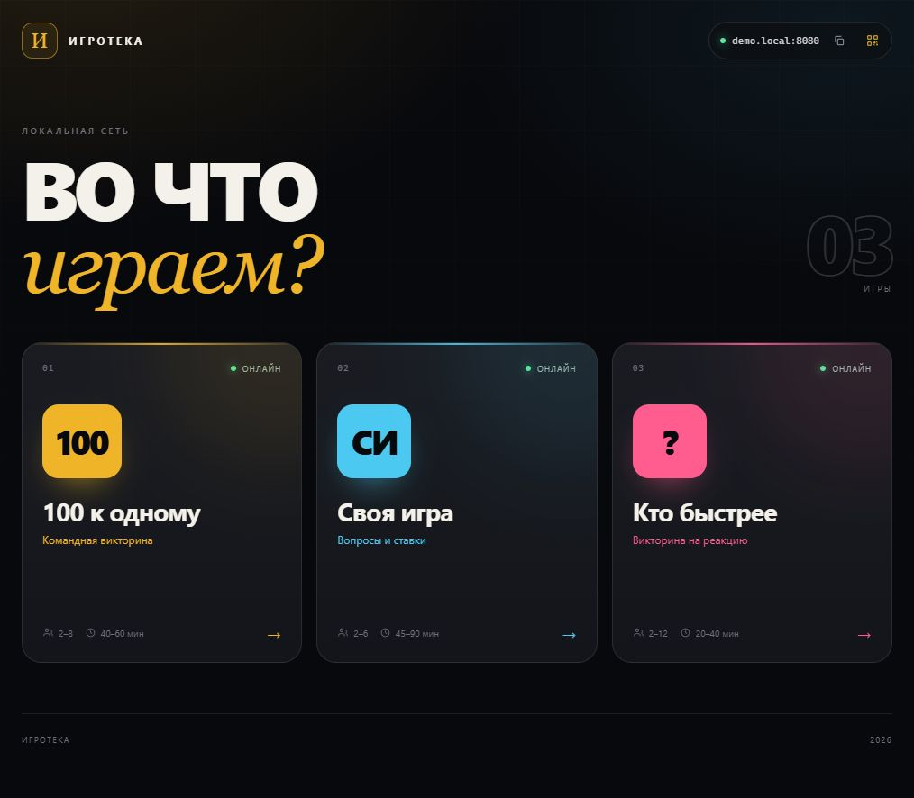

# Игротека

Локальная платформа для игр на одном экране: портал с карточками, QR для гостей и три независимые игры.

## Что скачать

1. **Node.js 22 или новее** — https://nodejs.org
2. **Репозиторий** — клонировать:
   ```bat
   git clone https://github.com/doozy69/igroteka.git
   cd igroteka
   ```
   или скачать ZIP: на GitHub **Code → Download ZIP**.
3. Больше ничего скачивать не нужно. `node_modules`, история игр и локальные данные в репозиторий не входят — зависимости установятся при первом запуске.

Docker для обычного запуска не нужен. Готовый образ описан в разделе [Docker](#docker).

## Запуск

1. Установите Node.js 22+.
2. Скачайте или клонируйте репозиторий.
3. Запустите:
   ```bat
   start.bat
   ```
   На Linux/macOS:
   ```bash
   npm start
   ```
4. Лаунчер установит зависимости, поднимет портал и игры и откроет браузер по LAN-адресу, например `http://192.0.2.10:8080/`.
5. `Ctrl+C` останавливает всё.

Проверка структуры и реестра:

```bat
npm run validate
```

| Что | Адрес |
|---|---|
| Портал | http://localhost:8080 |
| 100 к одному | http://localhost:8101 |
| Своя игра | http://localhost:8102 |
| Кто быстрее | http://localhost:8103 |

Гостям нужно открывать не `localhost`, а адрес компьютера в локальной сети — он показан в шапке портала и в QR-коде.

## Игры

- [100 к одному](docs/games/100k.md) — командная викторина, ведущий и ТВ-экран.
- [Своя игра](docs/games/svoy.md) — темы, ставки, кот в мешке и финал.
- [Кто быстрее](docs/games/quiz.md) — кнопочная викторина на реакцию.



## Как вносить правки

- **HTML/CSS/JS** — сохранить и обновить вкладку. Перезапуск не нужен.
- **Сервер игры** — `Ctrl+C` в окне игротеки и снова `start.bat`. Все игры перезапустятся за пару секунд.
- **Не запускайте второй `start.bat`**, пока работает первый: порты будут заняты.

## Структура

```
igroteka/
  games.json           реестр игр: название, порт, описание, цвет
  start.bat            одна команда запуска
  package.json         npm start и npm run validate
  Dockerfile            образ со всеми играми
  docker-compose.yml    запуск контейнера с портами
  tools/
    start-all.mjs      лаунчер: проверка портов, npm install, запуск, остановка
    validate.mjs       проверка реестра и структуры
  apps/
    portal/            общая панель, не содержит код игр
  games/
    100k/              самостоятельный проект
    svoy/              самостоятельный проект
    quiz/              самостоятельный проект
    _template/         шаблон новой игры
  docs/
    ARCHITECTURE.md    почему платформа устроена именно так
    CONTRACT.md        контракт между порталом и играми
    NEW_GAME.md        инструкция и промпт для создания новой игры
    games/             описание каждой игры
    images/            скриншоты и макеты
```

## Главное правило

Каждая игра — **отдельный проект**. У неё свой `package.json`, зависимости, данные и `AGENTS.md`. Она запускается сама по себе:

```bat
cd games\100k
npm install
npm start
```

Портал не импортирует код игр. Он читает `games.json` и проверяет, отвечает ли порт. Новую игру добавляют копированием `games/_template` и одной записью в `games.json`, без правок кода портала.

## Как добавить игру

1. Прочитайте `docs/NEW_GAME.md`.
2. Скопируйте `games/_template` в `games/<id>`.
3. Выберите свободный порт из диапазона `8104–8199`.
4. Реализуйте игру, проверьте её отдельно.
5. Добавьте запись в `games.json`.
6. Запустите `start.bat` и проверьте карточку на портале.

Для агента в `docs/NEW_GAME.md` есть готовый промпт: его можно отдать целиком, и агенту не придётся читать другие игры.

## Данные и бэкапы

- Паки вопросов лежат внутри игр: `games/<id>/questions/`.
- История и состояние — в `games/<id>/data/`.
- Портал ничего не хранит.
- Перед вечеринкой скопируйте папки `data/` и `questions/` в отдельное место. `data/` исключена из git.

## Локальная сеть

1. Компьютер и телефоны гостей — в одной Wi-Fi сети.
2. При первом запуске разрешите Node.js доступ в частных сетях (Windows Firewall).
3. Откройте портал на этом компьютере, нажмите **QR** и покажите код гостям.
4. Если гости не подключаются, проверьте, что в шапке портала показан адрес вида `192.168.x.x:8080`, а не `localhost`.

## Безопасность

Игры не имеют авторизации и рассчитаны на доверенную локальную сеть. Не пробрасывайте порты `8080–8199` в интернет. Если нужен доступ снаружи, ставьте reverse proxy с авторизацией или VPN.

## Docker

Готовый образ лежит в [Releases](https://github.com/doozy69/igroteka/releases): `igroteka-1.0.0-linux-amd64.tar`.

```bash
docker load -i igroteka-1.0.0-linux-amd64.tar
```

Запуск через `docker-compose.yml`:

```powershell
$env:PUBLIC_HOST = "192.0.2.10"
docker compose up -d --no-build
```

`PUBLIC_HOST` — LAN-IP компьютера. Он нужен, чтобы QR-коды и ссылки на игры вели на хост, а не на внутренний адрес контейнера.

Или без compose, одной командой:

```bash
docker run -d --name igroteka --restart unless-stopped \
  -p 8080:8080 -p 8101:8101 -p 8102:8102 -p 8103:8103 \
  -e NO_OPEN=1 -e PUBLIC_HOST=192.0.2.10 \
  -v "$PWD/games/100k/data:/app/games/100k/data" \
  -v "$PWD/games/svoy/data:/app/games/svoy/data" \
  -v "$PWD/games/quiz/data:/app/games/quiz/data" \
  igroteka:1.0.0
```

Образ собран под `linux/amd64`. Для Raspberry Pi/ARM:

```bash
docker buildx build --platform linux/arm64 -t igroteka:1.0.0 .
```

## Релизы

Установщик не нужен: это Node.js-приложение. Достаточно скачать ZIP из [Releases](https://github.com/doozy69/igroteka/releases), распаковать и запустить `start.bat` (нужен Node.js 22+).

В релизе:

- исходники в ZIP;
- Docker-образ `igroteka-1.0.0-linux-amd64.tar`;
- `SHA256SUMS` для проверки архива.

## Если что-то не работает

- **«Порты уже заняты»** — скорее всего, игротека уже запущена. Закройте старое окно или завершите процесс Node.
- **Портал открылся, игры «не запущена»** — подождите пару секунд: статус обновляется каждые 5 секунд.
- **Гости не открывают игру** — проверьте firewall и адрес в QR. `localhost` с телефона не работает.
- **Другая версия Node** — нужна 22+. Проверьте `node --version`.
