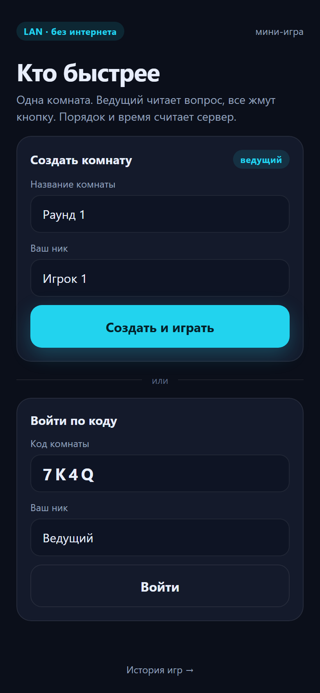
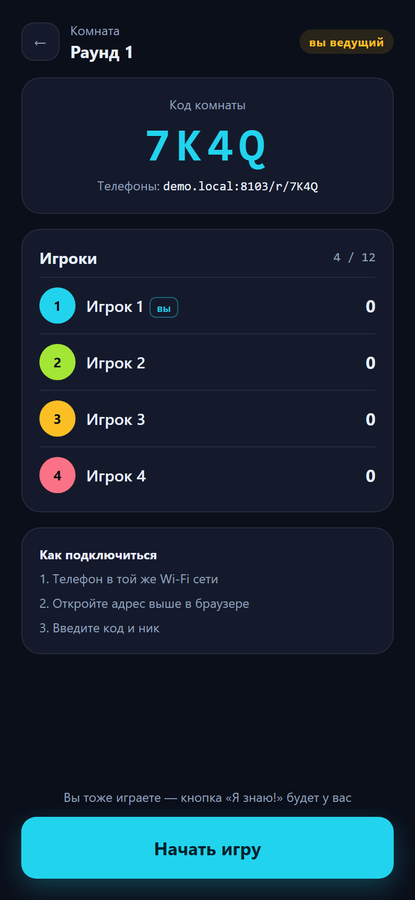
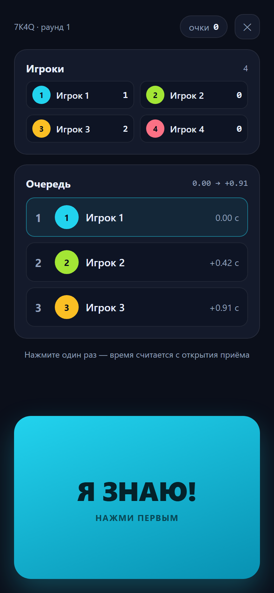
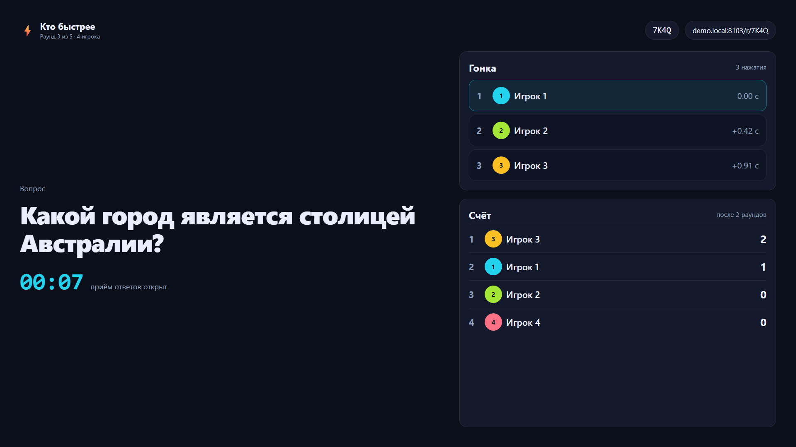

# Кто быстрее

[← Все игры](../../README.md)

Кнопочная LAN-викторина: ведущий читает вопрос, игроки жмут «Я знаю!» на телефонах, побеждает самый быстрый и точный.

| Параметр | Значение |
|---|---|
| Игроков | 2–12 |
| Длительность | 20–40 минут |
| Порт | `8103` |
| Формат | ведущий, общий экран, телефоны игроков |

## Как играют

1. Ведущий создаёт комнату и получает код.
2. Игроки открывают сайт, вводят код и ник.
3. Ведущий открывает приём ответов.
4. Игроки жмут «Я знаю!»; первый в очереди отвечает.
5. Очки, тайминги и история сохраняются в комнате.

## Роли

- **Ведущий** — создаёт комнату, открывает вопросы и ставит вердикт.
- **Экран** — показывает вопрос, очередь и табло.
- **Игроки** — жмут кнопку и отвечают.

## Экраны

| Страница | Адрес |
|---|---|
| Главная: создать или войти | `http://<LAN-IP>:8103/` |
| Комната | `http://<LAN-IP>:8103/r/<код>` |
| ТВ-табло | `http://<LAN-IP>:8103/r/<код>/tv` |
| История | `http://<LAN-IP>:8103/history` |

## Экраны игры









## Запуск

```bat
cd games\quiz
npm install
npm start
```

Или из корня платформы: `start.bat`, затем откройте карточку игры на портале.

## Данные

История матчей лежит в `games/quiz/data/history.json` и не попадает в git. Паки вопросов находятся в `data/question-packs.json`.
