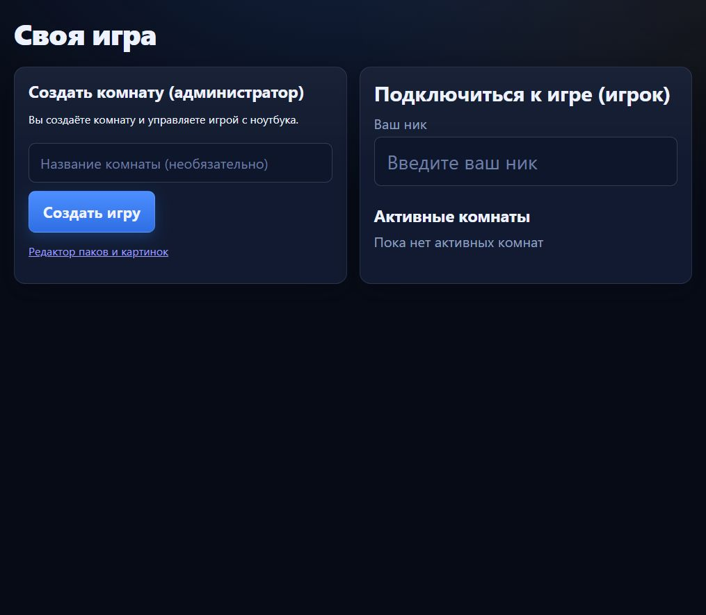

# Своя игра

[← Все игры](../../README.md)

Интеллектуальная викторина с темами, стоимостью вопросов, «котом в мешке», аукционами и финальным раундом.

| Параметр | Значение |
|---|---|
| Игроков | 2–6 |
| Длительность | 45–90 минут |
| Порт | `8102` |
| Формат | ведущий, общий экран, телефоны игроков |

## Как играют

1. Ведущий создаёт комнату и выбирает пак вопросов.
2. Игроки подключаются по QR-коду или вводят код комнаты.
3. Ведущий открывает темы и вопросы, игроки отвечают.
4. В финале игроки делают ставки и отвечают на общий вопрос.

## Роли

- **Ведущий** — управляет раундами, темами, ставками и ответами.
- **Экран** — показывает табло, вопрос и таймер.
- **Игроки** — выбирают вопросы и отвечают с телефонов.

## Экраны

| Страница | Адрес |
|---|---|
| Вход и создание игры | `http://<LAN-IP>:8102/` |
| Панель ведущего | `http://<LAN-IP>:8102/admin.html` |
| Общий экран | `http://<LAN-IP>:8102/display.html` |
| Телефон игрока | `http://<LAN-IP>:8102/player.html` |
| Редактор паков | `http://<LAN-IP>:8102/editor.html` |

Редактор по сети защищён токеном. Задайте `EDITOR_TOKEN` в окружении или локально в `game.config.json`; не коммитьте настоящий токен.

## Скриншот



## Запуск

```bat
cd games\svoy
npm install
npm start
```

Или из корня платформы: `start.bat`, затем откройте карточку игры на портале.

## Данные

Паки вопросов лежат в `games/svoy/questions/`, изображения — в `games/svoy/questions/images/`. История комнат хранится в памяти.
